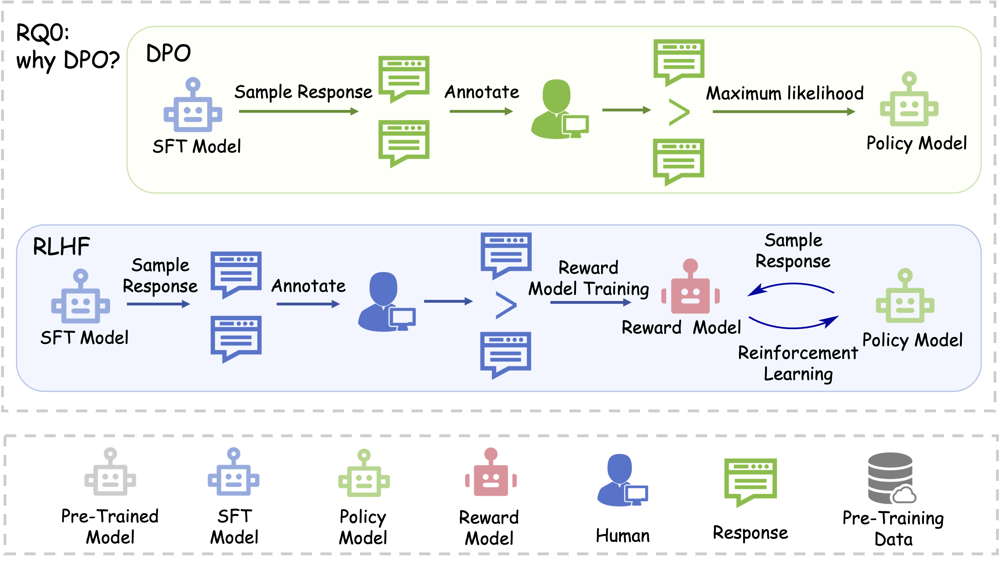
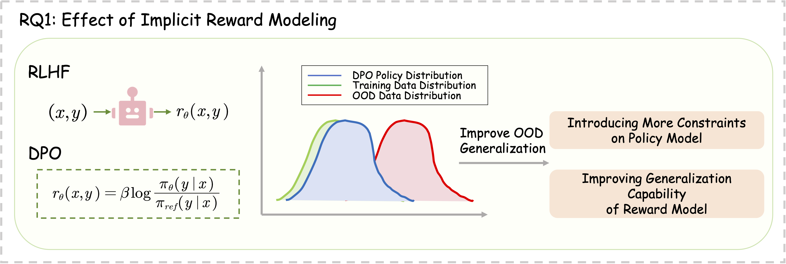
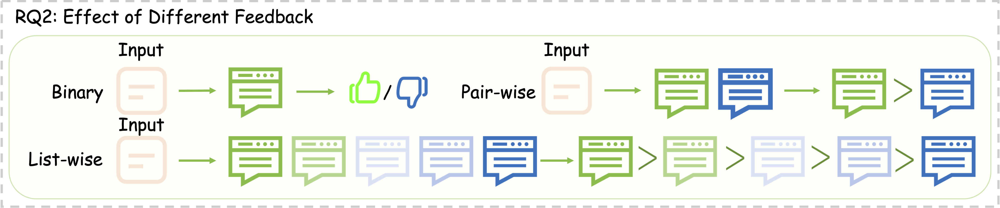
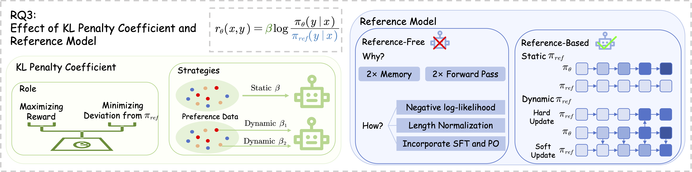
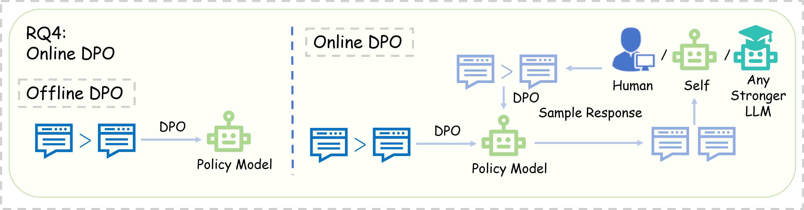
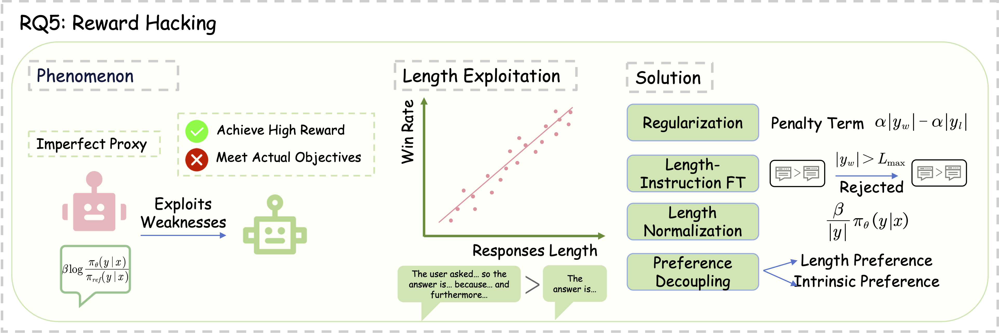
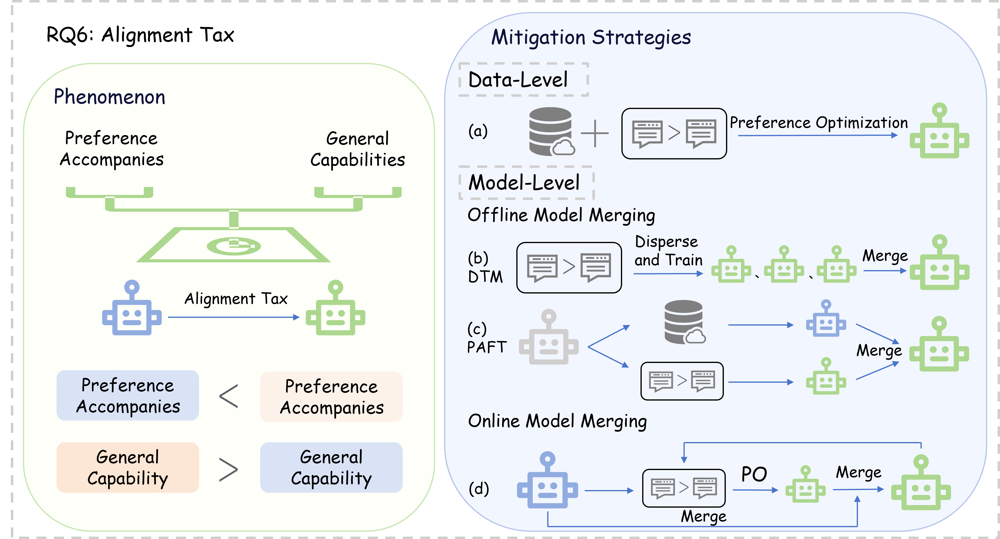
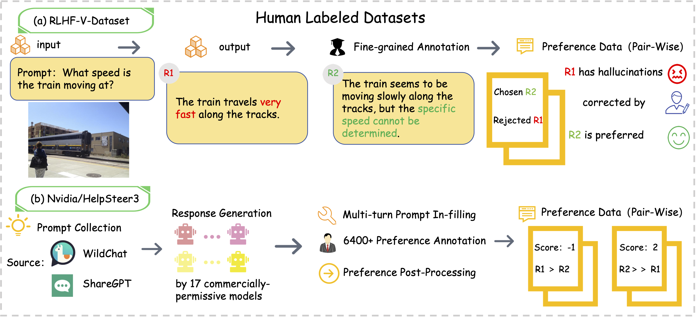
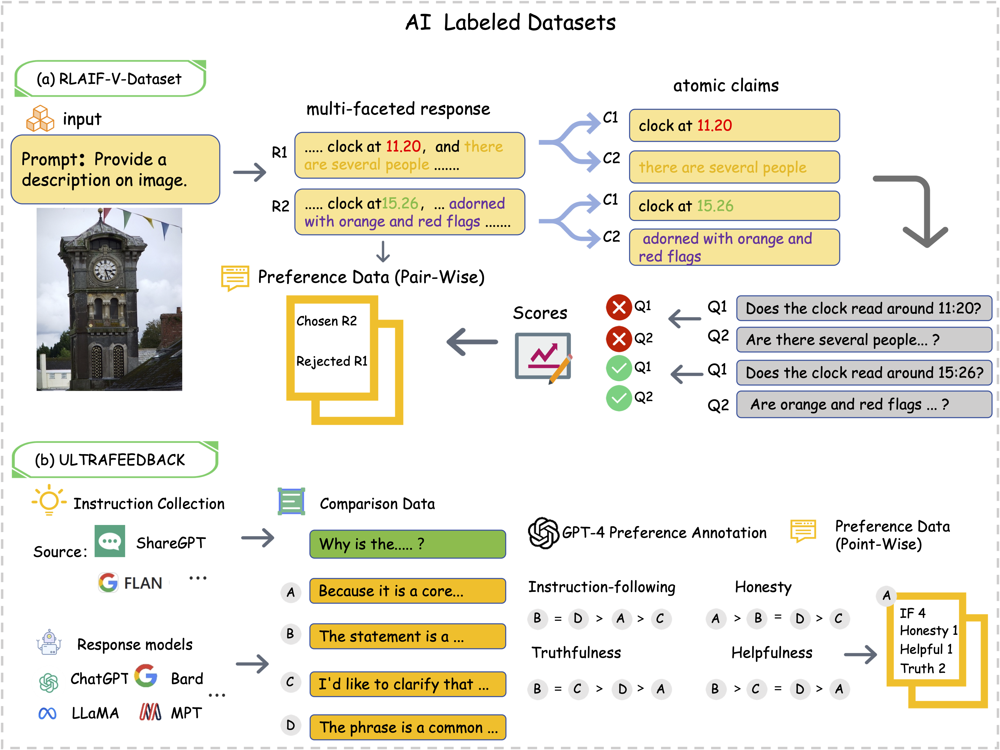

# A Comprehensive Survey of Direct Preference Optimization:<br> *Datasets, Theories, Variants, and Applications*

[](http://arxiv.org/abs/2410.15595)

## 📢 Updates

- **2026.06**: Our survey paper is accepted by TPAMI 2026!

- **2024.10**: We released a survey paper "[A Comprehensive Survey of Direct Preference Optimization: Datasets, Theories, Variants, and Applications](http://arxiv.org/abs/2410.15595)". Feel free to cite or open pull requests.

## 👀 Introduction

Welcome to the repository for our survey paper, "A Comprehensive Survey of Direct Preference Optimization: Datasets, Theories, Variants, and Applications". This repository provides resources and updates related to our research. For a detailed introduction, please refer to [our survey paper](http://arxiv.org/abs/2410.15595).


## 📒 Table of Contents

- [Research Questions and Variants](#-research-questions-and-variants)
  - [RQ0: Why DPO?](#rq0-why-dpo)
  - [RQ1: Effect of Implicit Reward Modeling](#rq1-effect-of-implicit-reward-modeling)
  - [RQ2: Effect of Different Feedback](#rq2-effect-of-different-feedback)
  - [RQ3: Effect of KL Penalty Coefficient and Reference Model](#rq3-effect-of-kl-penalty-coefficient-and-reference-model)
  - [RQ4: Online DPO](#rq4-online-dpo)
  - [RQ5: Reward Hacking](#rq5-reward-hacking)
  - [RQ6: Alignment Tax](#rq6-alignment-tax)
- [Datasets](#-datasets)
  - [Human Labeled Datasets](#human-labeled-datasets)
  - [AI Labeled Datasets](#ai-labeled-datasets)
- [Applications](#-applications)
  - [Application on Large Language Models](#application-on-large-language-models)
    - [Application on Reasoning](#application-on-reasoning)
    - [Application on Instruction-Following](#application-on-instruction-following)
    - [Application on Anti-Hallucination](#application-on-anti-hallucination)
    - [Application on Code-Generation](#application-on-code-generation)
  - [Application on Multi-modal Understanding and Generation](#application-on-multi-modal-understanding-and-generation)
    - [Multi-modal Understanding](#multi-modal-understanding)
    - [Multi-modal Generation](#multi-modal-generation)
  - [More Applications](#more-applications)

## 📄 Research Questions and Variants
### RQ0: Why DPO?

  * Training language models to follow instructions with human feedback [[Paper]](https://arxiv.org/abs/2203.02155) (2022.03)
  * Direct Preference Optimization: Your Language Model is Secretly a Reward Model [[Paper]](https://arxiv.org/abs/2305.18290) (2023.05)
  * Learning Dynamics of LLM Finetuning [[Paper]](https://arxiv.org/abs/2407.10490) (2024.07)

### RQ1: Effect of Implicit Reward Modeling

  * On the Limited Generalization Capability of the Implicit Reward Model Induced by Direct Preference Optimization [[Paper]](https://arxiv.org/abs/2409.03650) (2024.09)
  * Policy Optimization in RLHF: The Impact of Out-of-preference Data [[Paper]](https://arxiv.org/abs/2312.10584) (2023.12)
  * A General Theoretical Paradigm to Understand Learning from Human Preferences [[Paper]](https://arxiv.org/abs/2310.12036) (2023.10)
  * Generalizing Reward Modeling for Out-of-Distribution Preference Learning [[Paper]](https://link.springer.com/chapter/10.1007/978-3-031-70362-1_7) (2024.11)
  * Regularizing Hidden States Enables Learning Generalizable Reward Model for LLMs [[Paper]](https://arxiv.org/abs/2406.10216) (2024.06)
  * 3D-Properties: Identifying Challenges in DPO and Charting a Path Forward [[Paper]](https://openreview.net/forum?id=9Hxdixed7p) (2024.05)
  * Value-Incentivized Preference Optimization: A Unified Approach to Online and Offline RLHF [[Paper]](https://openreview.net/forum?id=Z6UD1rDbul) (2024.09)
  * Implicit Reward as the Bridge: A Unified View of SFT and DPO Connections [[Paper]](https://arxiv.org/abs/2507.00018) (2025.07)

### RQ2: Effect of Different Feedback

  * RAFT: Reward rAnked FineTuning for Generative Foundation Model Alignment [[Paper]](https://arxiv.org/abs/2304.06767) (2023.04)
  * RRHF: Rank Responses to Align Language Models with Human Feedback without tears [[Paper]](https://arxiv.org/abs/2304.05302) (2023.04)
  * Advancing LLM Reasoning Generalists with Preference Trees [[Paper]](https://arxiv.org/abs/2404.02078) (2024.04)
  * Step-DPO: Step-wise Preference Optimization for Long-chain Reasoning of LLMs [[Paper]](https://arxiv.org/abs/2406.18629) (2024.06)
  * KTO: Model Alignment as Prospect Theoretic Optimization [[Paper]](https://arxiv.org/abs/2402.01306) (2024.02)
  * Token-level Direct Preference Optimization [[Paper]](https://arxiv.org/abs/2404.11999) (2024.04)
  * Self-Play Fine-Tuning Converts Weak Language Models to Strong Language Models [[Paper]](https://arxiv.org/abs/2401.01335) (2024.01)
  * Contrastive Preference Optimization: Pushing the Boundaries of LLM Performance in Machine Translation [[Paper]](https://arxiv.org/abs/2401.08417) (2024.01)
  * Iterative Reasoning Preference Optimization [[Paper]](https://arxiv.org/abs/2404.19733) (2024.04)
  * Critical Tokens Matter: Token-Level Contrastive Estimation Enhence LLM's Reasoning Capability [[Paper]](https://arxiv.org/abs/2411.19943) (2024.11)
  * Building Math Agents with Multi-Turn Iterative Preference Learning [[Paper]](https://arxiv.org/abs/2409.02392) (2024.09)

### RQ3: Effect of KL Penalty Coefficient and Reference Model

  * β-DPO: Direct Preference Optimization with Dynamic β [[Paper]](https://arxiv.org/abs/2407.08639) (2024.07)
  * Understanding Reference Policies in Direct Preference Optimization [[Paper]](https://arxiv.org/abs/2407.13709) (2024.07)
  * From r to Q\*: Your Language Model is Secretly a Q-Function [[Paper]](https://arxiv.org/abs/2404.12358) (2024.04)
  * ORPO: Monolithic Preference Optimization without Reference Model [[Paper]](https://arxiv.org/abs/2403.07691) (2024.03)
  * SimPO: Simple Preference Optimization with a Reference-Free Reward [[Paper]](https://arxiv.org/abs/2405.14734) (2024.05)
  * Towards Analyzing and Understanding the Limitations of DPO: A Theoretical Perspective [[Paper]](https://arxiv.org/abs/2404.04626) (2024.04)
  * Is DPO Superior to PPO for LLM Alignment? A Comprehensive Study [[Paper]](https://arxiv.org/abs/2404.10719) (2024.04)
  * Learn Your Reference Model for Real Good Alignment [[Paper]](https://openreview.net/forum?id=H0qIWXXLUR) (2024.05)
  * KL Penalty Control via Perturbation for Direct Preference Optimization [[Paper]](https://arxiv.org/abs/2502.13177) (2025.02)
  * Exploratory Preference Optimization: Harnessing Implicit Q*-Approximation for Sample-Efficient RLHF [[Paper]](https://openreview.net/forum?id=QYigQ6gXNw) (2024.09)

### RQ4: Online DPO

  * Self-Rewarding Language Models [[Paper]](https://arxiv.org/abs/2401.10020) (2024.01)
  * Some things are more CRINGE than others: Iterative Preference Optimization with the Pairwise Cringe Loss [[Paper]](https://arxiv.org/abs/2312.16682) (2023.12)
  * Direct Language Model Alignment from Online AI Feedback [[Paper]](https://arxiv.org/abs/2402.04792) (2024.02)
  * sDPO: Don't Use Your Data All at Once [[Paper]](https://arxiv.org/abs/2403.19270) (2024.03)
  * OPTune: Efficient Online Preference Tuning [[Paper]](https://arxiv.org/abs/2406.07657) (2024.06)
  * Online DPO: Online Direct Preference Optimization with Fast-Slow Chasing [[Paper]](https://arxiv.org/abs/2406.05534) (2024.06)
  * Self-Play Fine-Tuning Converts Weak Language Models to Strong Language Models [[Paper]](https://arxiv.org/abs/2401.01335) (2024.01)
  * Understanding the performance gap between online and offline alignment algorithms [[Paper]](https://arxiv.org/abs/2405.08448) (2024.05)
  * Offline RLHF Methods Need More Accurate Supervision Signals [[Paper]](https://arxiv.org/abs/2408.09385) (2024.08)
  * Hybrid Preference Optimization for Alignment: Provably Faster Convergence Rates by Combining Offline Preferences with Online Exploration [[Paper]](https://openreview.net/forum?id=YBBXsVta2x) (2024.09)

### RQ5: Reward Hacking

  * AlpacaFarm: A Simulation Framework for Methods that Learn from Human Feedback [[Paper]](https://arxiv.org/abs/2305.14387) (2023.05)
  * A Long Way to Go: Investigating Length Correlations in RLHF [[Paper]](https://arxiv.org/abs/2310.03716) (2023.10)
  * Is Stack Overflow Obsolete? An Empirical Study of the Characteristics of ChatGPT Answers to Stack Overflow Questions [[Paper]](https://www.google.com/search?q=https://doi.org/10.1145/3613904.3642596) (2023.10)
  * How Far Can Camels Go? Exploring the State of Instruction Tuning on Open Resources [[Paper]](https://arxiv.org/abs/2306.04751) (2023.06)
  * Disentangling Length from Quality in Direct Preference Optimization [[Paper]](https://aclanthology.org/2024.findings-acl.297) (2024.08)
  * Following Length Constraints in Instructions [[Paper]](https://arxiv.org/abs/2406.17744) (2024.06)
  * Length Desensitization in Directed Preference Optimization [[Paper]](https://arxiv.org/abs/2409.06411) (2024.09)
  * Sail into the Headwind: Alignment via Robust Rewards and Dynamic Labels against Reward Hacking [[Paper]](https://openreview.net/forum?id=I8af9JdQTy) (2024.09)

### RQ6: Alignment Tax

  * Rethinking the Role of Proxy Rewards in Language Model Alignment [[Paper]](https://arxiv.org/abs/2402.03469) (2024.02)
  * Online merging optimizers for boosting rewards and mitigating tax in alignment [[Paper]](https://arxiv.org/abs/2405.17931) (2024.05)
  * SPO: Multi-Dimensional Preference Sequential Alignment With Implicit Reward Modeling [[Paper]](https://arxiv.org/abs/2405.12739) (2024.05)
  * PAFT: A Parallel Training Paradigm for Effective LLM Fine-Tuning [[Paper]](https://arxiv.org/abs/2406.17923) (2024.06)
  * Mitigating the Alignment Tax of RLHF [[Paper]](https://arxiv.org/abs/2309.06256) (2023.09)
  * Disperse-Then-Merge: Pushing the Limits of Instruction Tuning via Alignment Tax Reduction [[Paper]](https://arxiv.org/abs/2405.13432) (2024.05)
  * Controllable Preference Optimization: Toward Controllable Multi-Objective Alignment [[Paper]](https://arxiv.org/abs/2402.19085) (2024.02)
  * Beyond one-preference-fits-all alignment: Multi-objective direct preference optimization [[Paper]](https://aclanthology.org/2024.findings-acl.889/) (2024.08)
  * Restoring Calibration for Aligned Large Language Models: A Calibration-Aware Fine-Tuning Approach [[Paper]](https://openreview.net/forum?id=51tMpvPNSm) (2024.05)
<br>


## 📊 Datasets
### Human Labeled Datasets

  * Learning to summarize from human feedback [[Paper]](https://arxiv.org/abs/2009.01325) (2020.09)
  * WebGPT: Browser-assisted question-answering with human feedback [[Paper]](https://arxiv.org/abs/2112.09332) (2021.12)
  * HelpSteer: Multi-attribute Helpfulness Dataset for SteerLM [[Paper]](https://arxiv.org/abs/2311.09528) (2023.11)
  * HelpSteer2: Open-source dataset for training top-performing reward models [[Paper]](https://arxiv.org/abs/2406.08673) (2024.06)
  * HelpSteer3-Preference: Open Human-Annotated Preference Data across Diverse Tasks and Languages [[Paper]](https://arxiv.org/abs/2505.11475) (2025.05)
  * OpenAssistant Conversations -- Democratizing Large Language Model Alignment [[Paper]](https://arxiv.org/abs/2304.07327) (2023.04)
  * Understanding Dataset Difficulty with V-Usable Information (Introduces SHP) [[Paper]](https://proceedings.mlr.press/v162/ethayarajh22a.html) (2022.07)
  * tasksource: A Large Collection of NLP tasks (Introduces DPO-pairs) [[Paper]](https://aclanthology.org/2024.lrec-main.1361) (2024.05)
  * RLHF-V: Towards Trustworthy MLLMs via Behavior Alignment from Fine-Grained Correctional Human Feedback [[Paper]](https://www.google.com/search?q=https://openaccess.thecvf.com/content/CVPR2024/html/Yu_RLHF-V_Towards_Trustworthy_MLLMs_via_Behavior_Alignment_from_Fine-Grained_Correctional_CVPR_2024_paper.html) (2024.06)
  * Training a Helpful and Harmless Assistant with Reinforcement Learning from Human Feedback (Introduces HH-RLHF) [[Paper]](https://arxiv.org/abs/2204.05862) (2022.04)
  * MM-RLHF: The Next Step Forward in Multimodal LLM Alignment [[Paper]](https://arxiv.org/abs/2502.10391) (2025.02)
  * Judging LLM-as-a-Judge with MT-Bench and Chatbot Arena [[Paper]](https://arxiv.org/abs/2306.05685) (2023.06)
  * AlpacaFarm: A Simulation Framework for Methods that Learn from Human Feedback [[Paper]](https://arxiv.org/abs/2305.14387) (2023.05)
  * Towards Harmless Multimodal Assistants with Blind Preference Optimization (Introduces MMSafe-PO) [[Paper]](https://arxiv.org/abs/2503.14189) (2025.03)

### AI Labeled Datasets

  * RLAIF-V: Aligning MLLMs through Open-Source AI Feedback for Super GPT-4V Trustworthiness [[Paper]](https://arxiv.org/abs/2405.17220) (2024.05)
  * Step-DPO: Step-wise Preference Optimization for Long-chain Reasoning of LLMs [[Paper]](https://arxiv.org/abs/2406.18629) (2024.06)
  * UltraFeedback: Boosting Language Models with High-quality Feedback [[Paper]](https://arxiv.org/abs/2310.01377) (2023.10)
  * Distilabel Capybara DPO Dataset [[Dataset]](https://huggingface.co/datasets/argilla/distilabel-capybara-dpo-7k-binarized)
  * ChatML DPO Pairs (from Orca) [[Dataset]](https://www.google.com/search?q=https://huggingface.co/datasets/mlabonne/chatml-dpo-pairs)
  * Magpie: Alignment Data Synthesis from Scratch by Prompting Aligned LLMs with Nothing [[Paper]](https://arxiv.org/abs/2406.08464) (2024.06)
  * TLDR Preference DPO [[Dataset]](https://www.google.com/search?q=https://huggingface.co/datasets/davanstrien/tldr-preference-dpo)
  * Zerolink ZSQL-Postgres DPO [[Dataset]](https://huggingface.co/datasets/zerolink/zsql-postgres-dpo)
  * RewardBench: Evaluating Reward Models for Language Modeling [[Paper]](https://arxiv.org/abs/2403.13787) (2024.03)
  * RewardBench 2: Advancing Reward Model Evaluation [[Paper]](https://arxiv.org/abs/2506.01937) (2025.06)
  * VL-RewardBench: A Challenging Benchmark for Vision-Language Generative Reward Models [[Paper]](https://arxiv.org/abs/2411.17451) (2024.11)
  * Silkie: Preference Distillation for Large Visual Language Models (Introduces VLFeedback) [[Paper]](https://arxiv.org/abs/2312.10665) (2023.12)
  * SPA-VL: A Comprehensive Safety Preference Alignment Dataset for Vision Language Model [[Paper]](https://arxiv.org/abs/2406.12030) (2024.06)
  * Stack Exchange Preferences Dataset [[Dataset]](https://huggingface.co/datasets/HuggingFaceH4/stack-exchange-preferences)
  * Starling-7B: Improving LLM Helpfulness & Harmlessness with RLAIF (Introduces Nectar) [[Blog Post]](https://www.google.com/search?q=https://lmsys.org/blog/2023-11-21-starling/) (2023.11)
  * SlimOrca: An Open Dataset of GPT-4 Augmented FLAN Reasoning Traces [[Dataset]](https://www.google.com/search?q=https://huggingface.co/Open-Orca/SlimOrca)
  * CodeSteer: Symbolic-Augmented Language Models via Code/Text Guidance [[Paper]](https://arxiv.org/abs/2502.04350) (2025.02)
  * Mask-DPO: Generalizable Fine-grained Factuality Alignment of LLMs (Introduces ANAH) [[Paper]](https://arxiv.org/abs/2503.02846) (2025.03)
  * Unified Reward Model for Multimodal Understanding and Generation [[Paper]](https://arxiv.org/abs/2503.05236) (2025.03)
  * MM-IFEngine: Towards Multimodal Instruction Following [[Paper]](https://arxiv.org/abs/2504.07957) (2025.04)

<br>

## 🌐 Applications

### Application on Large Language Models

  * Qwen2 Technical Report [[Paper]](https://arxiv.org/abs/2407.10671) (2024.07)
  * The Llama 3 Herd of Models [[Paper]](https://arxiv.org/abs/2407.21783) (2024.07)
  * DeepSeek LLM: Scaling Open-Source Language Models with Longtermism [[Paper]](https://arxiv.org/abs/2401.02954) (2024.01)
  * Mixtral of Experts [[Paper]](https://arxiv.org/abs/2401.04088) (2024.01)
  * Baichuan 2: Open Large-scale Language Models [[Paper]](https://arxiv.org/abs/2309.10305) (2023.09)
  * Yi: Open Foundation Models by 01.AI [[Paper]](https://arxiv.org/abs/2403.04652) (2024.03)

#### Application on Reasoning

  * Step-DPO: Step-wise Preference Optimization for Long-chain Reasoning of LLMs [[Paper]](https://arxiv.org/abs/2406.18629) (2024.06)
  * Step-Controlled DPO: Leveraging Stepwise Error for Enhanced Mathematical Reasoning [[Paper]](https://arxiv.org/abs/2407.00782) (2024.07)
  * Iterative Reasoning Preference Optimization [[Paper]](https://arxiv.org/abs/2404.19733) (2024.04)
  * Self-Training with Direct Preference Optimization Improves Chain-of-Thought Reasoning [[Paper]](https://arxiv.org/abs/2407.18248) (2024.07)
  * MAPO: Advancing Multilingual Reasoning through Multilingual-Alignment-as-Preference Optimization [[Paper]](https://aclanthology.org/2024.acl-long.539) (2024.08)

#### Application on Instruction-Following

  * Self-play with Execution Feedback: Improving Instruction-following Capabilities of Large Language Models [[Paper]](https://arxiv.org/abs/2406.13542) (2024.06)
  * Enhancing and Assessing Instruction-Following with Fine-Grained Instruction Variants [[Paper]](https://arxiv.org/abs/2406.11301) (2024.06)
  * Conifer: Improving Complex Constrained Instruction-Following Ability of Large Language Models [[Paper]](https://arxiv.org/abs/2404.02823) (2024.04)
  * FIPO: Free-form Instruction-oriented Prompt Optimization with Preference Dataset and Modular Fine-tuning Schema [[Paper]](https://arxiv.org/abs/2402.11811) (2024.02)
  * RS-DPO: A Hybrid Rejection Sampling and Direct Preference Optimization Method for Alignment of Large Language Models [[Paper]](https://arxiv.org/abs/2402.10038) (2024.02)

#### Application on Anti-Hallucination

  * FLAME: Factuality-Aware Alignment for Large Language Models [[Paper]](https://arxiv.org/abs/2405.01525) (2024.05)
  * Halu-J: Critique-Based Hallucination Judge [[Paper]](https://arxiv.org/abs/2407.12943) (2024.07)
  * Fine-grained Hallucination Detection and Mitigation in Long-form Question Answering [[Paper]](https://arxiv.org/abs/2407.11930) (2024.07)
  * Fine-tuning Language Models for Factuality [[Paper]](https://arxiv.org/abs/2311.08401) (2023.11)

#### Application on Code-Generation

  * Code-Optimise: Self-Generated Preference Data for Correctness and Efficiency [[Paper]](https://arxiv.org/abs/2406.12502) (2024.06)
  * Stable Code Technical Report [[Paper]](https://arxiv.org/abs/2404.01226) (2024.04)
  * Performance-Aligned LLMs for Generating Fast Code [[Paper]](https://arxiv.org/abs/2404.18864) (2024.04)
  * Instruct-Code-Llama: Improving Capabilities of Language Model in Competition Level Code Generation by Online Judge Feedback [[Paper]](https://link.springer.com/chapter/10.1007/978-981-97-5669-8_12) (2024.07)

### Application on Multi-modal Understanding and Generation

#### Multi-modal Understanding

  * Silkie: Preference Distillation for Large Visual Language Models [[Paper]](https://arxiv.org/abs/2312.10665) (2023.12)
  * Aligning Modalities in Vision Large Language Models via Preference Fine-tuning [[Paper]](https://arxiv.org/abs/2402.11411) (2024.02)
  * RLHF-V: Towards Trustworthy MLLMs via Behavior Alignment from Fine-Grained Correctional Human Feedback [[Paper]](https://www.google.com/search?q=https://openaccess.thecvf.com/content/CVPR2024/html/Yu_RLHF-V_Towards_Trustworthy_MLLMs_via_Behavior_Alignment_from_Fine-Grained_Correctional_CVPR_2024_paper.html) (2024.06)
  * RLAIF-V: Aligning MLLMs through Open-Source AI Feedback for Super GPT-4V Trustworthiness [[Paper]](https://arxiv.org/abs/2405.17220) (2024.05)
  * Detecting and Mitigating Hallucination in Large Vision Language Models via Fine-Grained AI Feedback [[Paper]](https://arxiv.org/abs/2404.14233) (2024.04)
  * Direct Preference Optimization of Video Large Multimodal Models from Language Model Reward [[Paper]](https://arxiv.org/abs/2404.01258) (2024.04)
  * LLaVA-NeXT: A Strong Zero-shot Video Understanding Model [[Blog Post]](https://llava-vl.github.io/blog/2024-04-30-llava-next-video/) (2024.04)
  * Qwen2-Audio Technical Report [[Paper]](https://arxiv.org/abs/2407.10759) (2024.07)
  * CAT: Enhancing Multimodal Large Language Model to Answer Questions in Dynamic Audio-Visual Scenarios [[Paper]](https://arxiv.org/abs/2403.04640) (2024.03)

#### Multi-modal Generation

  * Diffusion Model Alignment Using Direct Preference Optimization [[Paper]](https://arxiv.org/abs/2311.12908) (2023.11)
  * Using Human Feedback to Fine-tune Diffusion Models without Any Reward Model [[Paper]](https://arxiv.org/abs/2311.13231) (2023.11)
  * A Dense Reward View on Aligning Text-to-Image Diffusion with Preference [[Paper]](https://arxiv.org/abs/2402.08265) (2024.02)
  * Tango 2: Aligning Diffusion-based Text-to-Audio Generations through Direct Preference Optimization [[Paper]](https://arxiv.org/abs/2404.09956) (2024.04)
  * Emo-DPO: Controllable Emotional Speech Synthesis through Direct Preference Optimization [[Paper]](https://arxiv.org/abs/2409.10157) (2024.09)
  * SpeechAlign: Aligning Speech Generation to Human Preferences [[Paper]](https://arxiv.org/abs/2404.05600) (2024.04)
  * Speechworthy Instruction-tuned Language Models [[Paper]](https://arxiv.org/abs/2409.14672) (2024.09)

### More Applications

  * Aligning protein generative models with experimental fitness via Direct Preference Optimization [[Paper]](https://www.biorxiv.org/content/10.1101/2024.05.20.595026v1) (2024.05)
  * A Human Feedback Strategy for Photoresponsive Molecules in Drug Delivery [[Paper]](https://www.mdpi.com/1999-4923/16/8/1014) (2024.07)
  * ConPro: Learning Severity Representation for Medical Images using Contrastive Learning and Preference Optimization [[Paper]](https://arxiv.org/abs/2404.18831) (2024.04)
  * Exploring Text-to-Motion Generation with Human Preference [[Paper]](https://arxiv.org/abs/2404.09445) (2024.04)
  * On Softmax Direct Preference Optimization for Recommendation [[Paper]](https://arxiv.org/abs/2406.09215) (2024.06)
  * Finetuning Large Language Model for Personalized Ranking [[Paper]](https://arxiv.org/abs/2405.16127) (2024.05)


## 📑 Citation
If you find this work useful, welcome to cite us.

```bib
@misc{xiao2024comprehensivesurveydirectpreference,
      title={A Comprehensive Survey of Direct Preference Optimization: Datasets, Theories, Variants, and Applications}, 
      author={Wenyi Xiao and Zechuan Wang and Leilei Gan and Shuai Zhao and Wanggui He and Luu Anh Tuan and Long Chen and Hao Jiang and Zhou Zhao and Fei Wu},
      year={2024},
      eprint={2410.15595},
      archivePrefix={arXiv},
      primaryClass={cs.AI},
      url={[https://arxiv.org/abs/2410.15595](https://arxiv.org/abs/2410.15595)}, 
}
